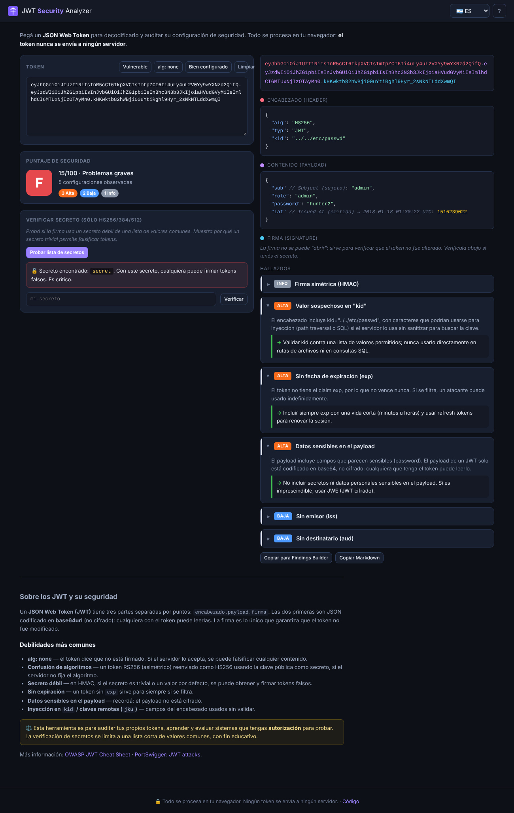

# JWT Security Analyzer 🔐

> 🇬🇧 [Read in English](README.md)

**Pegá un JSON Web Token y obtené su decodificación y una auditoría de configuraciones inseguras:** `alg: none`, confusión de algoritmos, secretos de firma débiles, falta de expiración, datos sensibles en el payload, inyección en `kid` y más. Cada hallazgo viene con una explicación clara y cómo corregirlo. Todo corre en tu navegador: el token nunca sale de tu equipo.

**🔗 Demo: https://ulisespignatelli.github.io/jwt-security-analyzer/**



## Por qué

Los JSON Web Token están en todas partes en la autenticación web y de APIs, y son una fuente habitual de hallazgos en pentests. Pero un JWT es solo JSON codificado en base64url: el encabezado y el payload **no están cifrados**, solo la firma los protege, y los errores clásicos (`alg: none`, secretos HMAC débiles, confusión de algoritmos, sin expiración) se repiten una y otra vez.

Esta herramienta decodifica el token y lo **audita como lo haría un revisor de seguridad**, convirtiendo cada debilidad en una explicación y una recomendación. Sirve como analizador rápido durante una evaluación y, al mismo tiempo, para entender *por qué* cada configuración es peligrosa.

## Funcionalidades

- 🔍 **Decodificación:** token coloreado, más encabezado y payload como JSON formateado, con cada claim registrado anotado (`exp`, `iat`, `nbf` mostrados como fechas UTC legibles).
- 🛡️ **Auditoría de seguridad** con calificación (A–F) y puntaje 0–100. Detecta:
  - `alg: none` o algoritmo ausente;
  - riesgo de **confusión de algoritmos** (RS/ES/PS → HS);
  - inyección en `kid` (path traversal / SQLi) y claves remotas (`jku` / `x5u`);
  - **falta de expiración o vida muy larga**, `nbf` incoherente con `iat`;
  - **datos sensibles en el payload** (de forma recursiva);
  - falta de `iss` / `aud`.
- 🔑 **Verificación de secreto débil (HS256/384/512):** prueba la firma contra una lista de secretos comunes o por defecto, para demostrar por qué un secreto trivial permite falsificar tokens, más un campo para probar tu propio secreto. El HMAC se calcula localmente con la Web Crypto API.
- 📚 **Educativo:** cada hallazgo explica el riesgo y la solución, y hay una guía integrada sobre seguridad de JWT.
- 🔗 **Exportación:** copiá los hallazgos como Markdown o como JSON listo para pegar en [Pentest Findings Builder](https://github.com/ulisespignatelli/pentest-findings-builder).
- 🌐 **Bilingüe** (ES/EN) y responsive.

## Seguridad y privacidad desde el diseño

Un JWT muchas veces **es** una credencial, así que toda la herramienta está pensada para no filtrarlo:

| Control | Implementación |
|---|---|
| El token no sale del navegador | Sitio estático; la CSP define `connect-src 'none'`, así que la página no puede hacer ninguna petición de red |
| Prevención de XSS | Todo valor del token se escapa antes de mostrarse (un token malicioso no puede inyectar script) |
| CSP estricta | `script-src 'self'`, sin scripts en línea, `form-action 'none'`, `object-src 'none'` |
| Criptografía local | Verificación HMAC con Web Crypto (`crypto.subtle`); `crypto` de Node en los tests |
| Alcance | La verificación de secretos solo prueba una lista corta incluida, sobre tokens que pegás vos: es educativa, no una herramienta de ataque remoto |
| Cadena de suministro | Cero dependencias; CodeQL y Dependabot activados |

Más detalles en [SECURITY.md](SECURITY.md).

## Cómo funciona

- JavaScript puro, sin compilación ni framework, alojado gratis en GitHub Pages.
- `jwt.js` es **puro y sin acceso al DOM**, así que el mismo código corre en el navegador y en Node para los tests.
- La verificación HMAC está validada contra el token canónico de `jwt.io`, así que es interoperable con bibliotecas JWT reales.

## Uso local

```bash
cd site && python3 -m http.server 8000   # abrir http://localhost:8000
node --test                              # tests (Node 18 o superior, sin instalar nada)
```

## Créditos y licencia

- Referencias: [OWASP JWT Cheat Sheet](https://cheatsheetseries.owasp.org/cheatsheets/JSON_Web_Token_for_Java_Cheat_Sheet.html), [PortSwigger JWT attacks](https://portswigger.net/web-security/jwt), [RFC 7519](https://www.rfc-editor.org/rfc/rfc7519).
- El código se distribuye bajo licencia [MIT](LICENSE).

> ⚖️ Hecha para auditar tus propios tokens, aprender y realizar pruebas de seguridad **autorizadas**.
