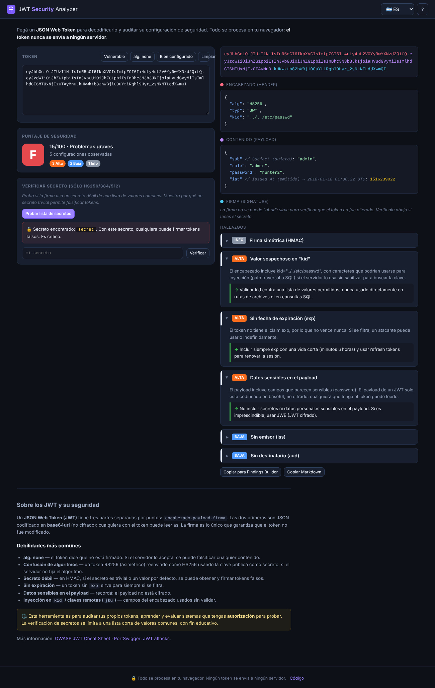
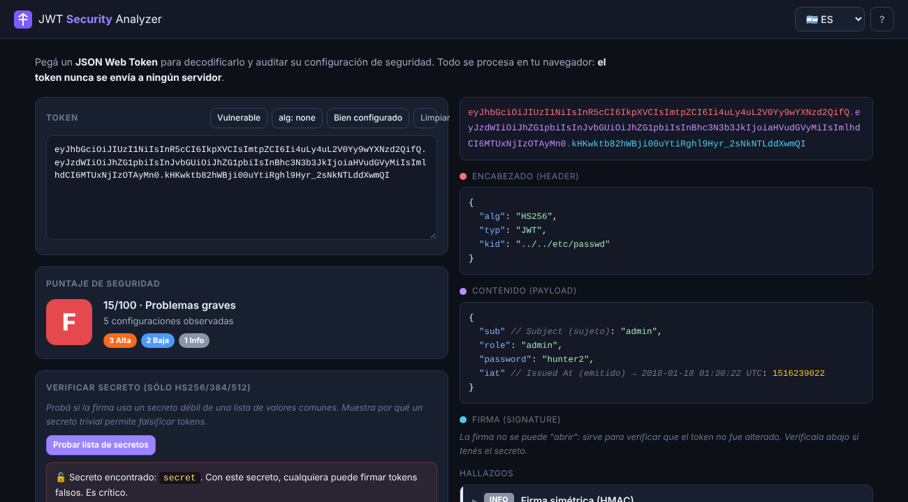
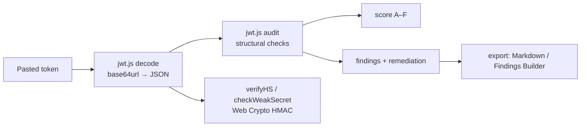

# JWT Security Analyzer 🔐

> 🇪🇸 [Leer en español](README.es.md)

**Paste a JSON Web Token and get it decoded and audited for insecure configurations — `alg: none`, algorithm confusion, weak signing secrets, missing expiration, sensitive data in the payload, `kid` injection and more. Each finding comes with a plain explanation and how to fix it. Everything runs in your browser, so the token never leaves your machine.**

[](https://ulisespignatelli.github.io/jwt-security-analyzer/)
[](https://github.com/ulisespignatelli/jwt-security-analyzer/actions/workflows/tests.yml)
[](https://github.com/ulisespignatelli/jwt-security-analyzer/actions/workflows/codeql.yml)


[](LICENSE)

**🔗 Live: https://ulisespignatelli.github.io/jwt-security-analyzer/**



## Why

JSON Web Tokens are everywhere in modern web and API authentication, and they are a recurring source of findings in pentests. But a JWT is just base64url-encoded JSON: the header and payload are **not encrypted**, only the signature protects them — and the classic mistakes (`alg: none`, weak HMAC secrets, algorithm confusion, no expiration) keep showing up.

This tool decodes a token and **audits it like a security reviewer would**, turning each weakness into an explanation and a remediation. It is built to be useful both as a quick analyzer during an assessment and as a way to actually understand *why* each configuration is dangerous.

## Features

- 🔍 **Decode:** colored token, plus header and payload as pretty-printed JSON with each registered claim annotated (`exp`, `iat`, `nbf` shown as human-readable UTC dates).
- 🛡️ **Security audit** with a letter grade (A–F) and a 0–100 score. Detects:
  - `alg: none` / missing algorithm
  - **algorithm confusion** risk (RS/ES/PS → HS)
  - `kid` injection (path traversal / SQLi) and remote keys (`jku` / `x5u`)
  - **missing / very long expiration**, inconsistent `nbf` vs `iat`
  - **sensitive data in the payload** (recursively)
  - missing `iss` / `aud`
- 🔑 **Weak secret check (HS256/384/512):** verifies the signature against a bundled list of common/default secrets to demonstrate why a trivial secret lets anyone forge tokens — plus a field to test your own secret. HMAC is computed locally with the Web Crypto API.
- 📚 **Educational:** every finding explains the risk and the fix, and there is a built-in primer on JWT security.
- 🔗 **Export:** copy findings as Markdown or as JSON ready to drop into [Pentest Findings Builder](https://github.com/ulisespignatelli/pentest-findings-builder).
- 🌐 **Bilingual** (ES/EN) and responsive.



## Security & privacy by design

A JWT often **is** a credential, so the whole tool is built around not leaking it:

| Control | Implementation |
|---|---|
| The token never leaves the browser | Static site; the CSP sets `connect-src 'none'`, so the page cannot make network requests at all |
| XSS prevention | Every value from the token is HTML-escaped before rendering (crafted tokens can't inject script) |
| Strict CSP | `script-src 'self'`, no inline scripts, `form-action 'none'`, `object-src 'none'` |
| Local crypto | HMAC verification via Web Crypto (`crypto.subtle`); Node `crypto` in tests |
| Scope | The secret check only tries a short bundled list, on tokens you paste yourself — educational, not a remote attack tool |
| Supply chain | Zero dependencies; CodeQL and Dependabot enabled |

See [SECURITY.md](SECURITY.md).

## How it works



- Vanilla JavaScript, no build step, no framework — hosted for free on GitHub Pages.
- `jwt.js` is **pure and DOM-free**, so the exact same code runs in the browser and in Node for the tests.
- The HMAC verification is validated against the canonical `jwt.io` token, so it is interoperable with real JWT libraries.

## Run locally

```bash
git clone https://github.com/ulisespignatelli/jwt-security-analyzer.git
cd jwt-security-analyzer/site
python3 -m http.server 8000      # open http://localhost:8000
```

Tests (Node ≥ 18, no install needed):

```bash
node --test
```

## Roadmap

- [ ] RSA/ECDSA signature verification (paste a public key / JWKS)
- [ ] Detect `alg` confusion by testing a provided public key as an HMAC secret
- [ ] Diff two tokens side by side

## Credits & license

- References: [OWASP JWT Cheat Sheet](https://cheatsheetseries.owasp.org/cheatsheets/JSON_Web_Token_for_Java_Cheat_Sheet.html), [PortSwigger JWT attacks](https://portswigger.net/web-security/jwt), [RFC 7519](https://www.rfc-editor.org/rfc/rfc7519).
- Code licensed under [MIT](LICENSE).

> ⚖️ Built for auditing your own tokens, learning, and **authorized** security testing.
